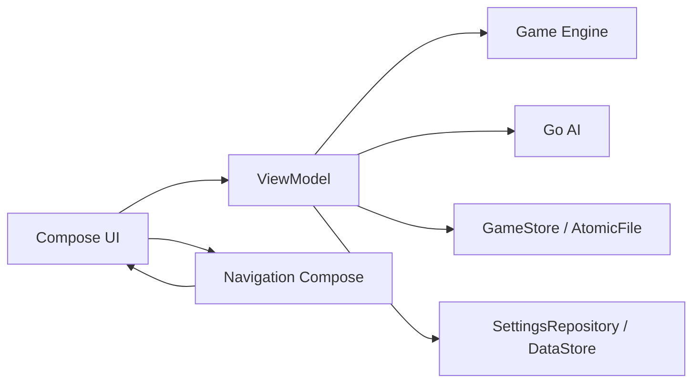
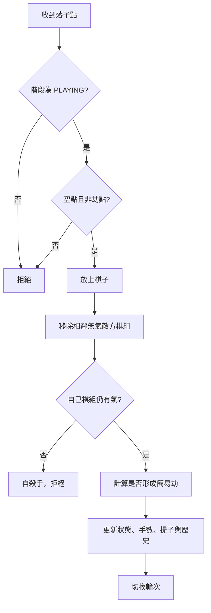
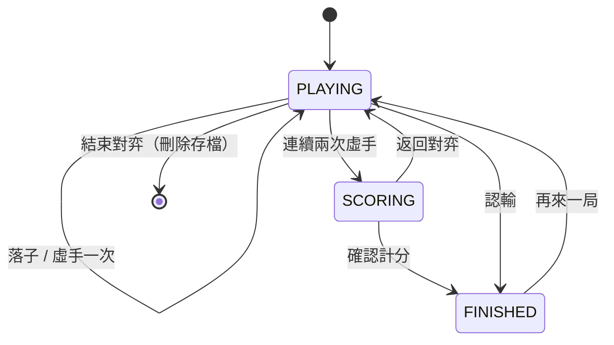

# mini圍棋 系統架構與技術文件

本文件說明 mini圍棋的技術選型、程式分層、核心資料結構、執行流程、存檔策略、建置設定與測試方式。

## 1. 技術總覽

| 項目 | 內容 |
| --- | --- |
| 語言 | Kotlin 2.2.20 |
| UI | Jetpack Compose、Material 3 |
| 建置 | Gradle 8.14.3、Android Gradle Plugin 8.13.0、Kotlin DSL、Version Catalog |
| compileSdk / targetSdk | 36 |
| minSdk | 26（Android 8.0） |
| Java / JVM Target | 17 |
| 狀態管理 | ViewModel + StateFlow |
| 導覽 | Navigation Compose 2.8.5，型別安全路由 |
| 設定儲存 | DataStore Preferences |
| 對局儲存 | JSON + AtomicFile |
| 序列化 | kotlinx.serialization JSON 1.8.1 |
| 測試 | JUnit 4、kotlinx-coroutines-test |
| 網路 | 無網路權限、完全離線 |

## 2. 整體分層



### 各層責任

- **engine/**：純 Kotlin 的棋盤、規則與計分，不依賴 Android。
- **ai/**：啟發式 AI，只依賴 engine。
- **data/**：設定與對局存檔，提供 `GameStore` 介面。
- **ui/**：Compose 畫面、ViewModel、導覽與主題。
- **app/src/test/**：JVM 單元測試，涵蓋規則、計分、AI、存檔與座標。

## 3. 套件結構

```text
com.vibecode.minigo
├── MainActivity.kt
├── engine
│   ├── Stone.kt
│   ├── Point.kt
│   ├── Board.kt
│   ├── GameState.kt
│   ├── GameEngine.kt
│   └── Scoring.kt
├── ai
│   ├── AiLevel.kt
│   └── GoAi.kt
├── data
│   ├── GameConfig.kt
│   ├── GameRepository.kt
│   └── SettingsRepository.kt
└── ui
    ├── Destinations.kt
    ├── MiniGoApp.kt
    ├── common
    │   ├── Components.kt
    │   └── GoCoordinates.kt
    ├── game
    │   ├── GameScreen.kt
    │   ├── GameViewModel.kt
    │   └── BoardCanvas.kt
    ├── home
    │   ├── HomeScreen.kt
    │   └── HomeViewModel.kt
    ├── setup
    │   └── GameSetupScreen.kt
    ├── settings
    │   ├── SettingsScreen.kt
    │   └── SettingsViewModel.kt
    ├── tutorial
    │   └── TutorialScreen.kt
    ├── about
    │   └── AboutScreen.kt
    └── theme
        ├── Color.kt
        ├── Theme.kt
        └── Type.kt
```

## 4. 規則引擎

### 4.1 棋盤模型

`Board` 是不可變資料結構：

```kotlin
data class Board(
    val size: Int,
    val cells: List<Stone>,
)
```

- `Stone`：`EMPTY`、`BLACK`、`WHITE`。
- `Point(x, y)`：左上角為 `(0, 0)`。
- `groupAt(point)`：以 flood fill 取得棋組、氣與顏色。
- `remove(points)`：提子後產生新棋盤。

不可變模型讓 AI 模擬與 undo 快照能安全共用棋盤資料，不需要額外同步。

### 4.2 對局狀態

`GameState` 包含：

| 欄位 | 說明 |
| --- | --- |
| `board` | 目前棋盤 |
| `toPlay` | 輪到哪一方 |
| `blackCaptures` / `whiteCaptures` | 提子數 |
| `moveNumber` | 手數 |
| `lastMove` | 最後一手 |
| `koPoint` | 簡易劫禁入點 |
| `passes` | 連續虛手次數 |
| `phase` | `PLAYING` / `SCORING` / `FINISHED` |
| `endReason` | `NONE` / `TWO_PASSES` / 認輸 |
| `deadStones` | 計分時標記的死子 |
| `history` | undo 快照，最多 80 筆 |

### 4.3 落子流程



- **提子**：只檢查落子點相鄰的敵方棋組。
- **自殺手**：先提子再檢查自己棋組的氣，允許「提子自救」。
- **簡易劫**：若提掉單顆棋子，且己方落子後為單顆棋且只剩一氣，將被提點設為 `koPoint`。
- **虛手**：連續兩次虛手進入 `SCORING`。

### 4.4 計分

`Scoring` 採中國規則數子法：

1. 移除 `deadStones`。
2. 計算雙方盤面棋子數。
3. 對每個空白連通區域 flood fill，記錄邊界顏色。
4. 只被單一顏色包圍的空點算該方地盤；雙方交界算中立。
5. 黑分 = 黑子 + 黑地。
6. 白分 = 白子 + 白地 + 6.5 貼目。
7. 比較分數決定勝負與勝差。

## 5. AI 設計

### 5.1 難度

| 難度 | 策略 |
| --- | --- |
| 入門（BEGINNER） | 合法手隨機，部分情況由基礎評分挑選。 |
| 初級（EASY） | 以靜態評分選最佳手，優先提子、叫吃、避免自填氣。 |
| 中級（MEDIUM） | 靜態評分前 10 名再做一手對手威脅評估。 |

### 5.2 靜態評分

`GoAi.staticScore()` 考量：

- 提子數（高權重）。
- 救出只剩一氣的己方棋組。
- 讓對方棋組進入叫吃。
- 避免自陷叫吃。
- 連接己方棋子。
- 遠離邊角、靠近中央。
- 靠近最後一手，鼓勵局部應對。
- 少量隨機擾動，避免每局完全一致。

### 5.3 時間預算與取消

- 9 路：700ms。
- 13 路：1500ms。
- `chooseMove()` 接受 `shouldStop` 回呼；ViewModel 以 coroutine 的 `isActive` 傳入。
- 超過時間會回傳目前已找到的合法手，不會因逾時直接虛手。
- AI 與提示計算都在 `Dispatchers.Default` 執行。

### 5.4 效能優化

- 模擬落子使用 `recordHistory = false`，不複製 undo 歷史。
- `legalMoves()` 內部也使用不記錄歷史的模擬。
- 中級只對前 10 名候選做一手前瞻，控制 13 路成本。

## 6. 狀態管理與事件

### GameViewModel

- 以 `StateFlow<GameUiState>` 暴露畫面狀態。
- 以 `SharedFlow<GameEvent>` 傳送一次性事件：
  - 非法手原因
  - 無提示
  - 無法悔棋
  - 存檔失敗
  - 電腦虛手
  - 結束對局／返回
- 建構時注入 `GameStore`，不使用 `AndroidViewModel`，方便測試。
- `GameUiState` 包含 `loading`、`config`、`game`、`thinking`、`hint`、`hintLoading`。

### 對局流程狀態機



## 7. 存檔設計

### 7.1 對局存檔

`SavedGame`：

```kotlin
@Serializable
data class SavedGame(
    val version: Int = 1,
    val config: GameConfig,
    val state: GameState,
)
```

- 檔案：`filesDir/current_game.json`
- 寫入：`android.util.AtomicFile`
- 寫入失敗會由 `GameEvent.SaveFailed` 提示。
- 每次落子／虛手／標記死子後延遲 80ms 寫入；離開或結束前會等待待寫入工作完成。
- `GameConfig.sessionId` 用來區分新局與舊存檔，避免程序重建時誤讀舊局。
- undo 歷史最多 80 筆，控制存檔大小。

### 7.2 設定

`SettingsRepository` 使用 DataStore Preferences 儲存：

- 顯示模式
- 動態配色
- 顯示座標
- 落子震動
- 預設棋盤
- 預設難度
- 預設模式
- 預設執子
- 是否看過教學

## 8. 導覽

使用 Navigation Compose 型別安全路由，路由定義於 `ui/Destinations.kt`：

- `HomeDestination`
- `SetupDestination`
- `GameDestination`（棋盤、模式、難度、執子、局號）
- `ResumeDestination`
- `TutorialDestination`
- `SettingsDestination`
- `AboutDestination`

`GameDestination` 使用扁平 Int/String 欄位，再轉成 `GameConfig`，避免巢狀型別在 Bundle 序列化上的限制。

## 9. 畫面與繪製

### 棋盤

- 使用 Compose `Canvas` 繪製木質背景、格線、星位、棋子、座標。
- 棋子使用徑向漸層與陰影。
- 最後一手為紅色圓環；提示為藍色圓環與座標。
- 死子以 X 標記。
- 點擊位置會換算成最近的交叉點，並依棋盤尺寸自適應。
- 對局畫面依可用高度限制棋盤尺寸，避免橫向時控制列被推到畫面外。

### 主題

- Material 3 自訂色盤。
- 支援淺色、深色、跟隨系統。
- Android 12+ 支援 dynamic color。
- 系統列圖示會跟隨 App 主題切換。

## 10. 建置設定

### buildTypes

| Build Type | R8 | 資源縮減 | 簽章 | 版本後綴 |
| --- | --- | --- | --- | --- |
| debug | 否 | 否 | Debug | `-debug` |
| prerelease | 是 | 是 | Debug | `-prerelease` |
| release | 是 | 是 | 需正式簽章 | 無 |

本次 GitHub Pre-release 使用 `prerelease`，版本為 `1.0.0-prerelease`（versionCode 12）。

### 依賴

版本集中管理於 `gradle/libs.versions.toml`：

- Compose BOM 2025.02.00
- Activity Compose 1.10.1
- Navigation Compose 2.8.5
- Lifecycle 2.8.5
- DataStore 1.1.7
- kotlinx.serialization 1.8.1

## 11. 測試

目前 23 項 JVM 單元測試：

- `EngineTest`：提子、自殺手、劫、虛手、快照、不記錄歷史、undo 上限。
- `ScoringTest`：數子、死子、中立區、貼目。
- `GoAiTest`：各難度合法手、提子、虛手、時間預算、取消。
- `PersistenceTest`：存檔 JSON round-trip。
- `GoCoordinatesTest`：座標轉換。
- `DestinationsTest`：導覽設定轉換。

指令：

```powershell
.\gradlew.bat testDebugUnitTest
.\gradlew.bat lintDebug
```

## 12. 安全性與隱私

- 無 `INTERNET` 權限。
- 無帳號、廣告、分析或第三方追蹤 SDK。
- 對局與設定只存在本機。
- 對局使用 AtomicFile 寫入，降低毀損風險。
- `prerelease` 使用 Debug 金鑰簽署，不可視為正式發行簽章。

## 13. 已知技術限制

- 棋盤以 `List<Stone>` 表示，AI 會建立大量短生命週期物件；目前規模可接受。
- 採簡易劫而非全局同形再現（superko）。
- 死子需手動標記。
- 無 19 路與線上對戰。
- 音效、落子二次確認、領地視覺化尚未實作。

## 14. 後續擴充方向

- 音效與錯誤震動回饋。
- 領地視覺化與手數標記。
- 讓子棋與 19 路。
- 棋譜記錄、復盤與統計。
- 更強的 AI 或可調時間控制。
- Compose UI 測試與 Macrobenchmark。
