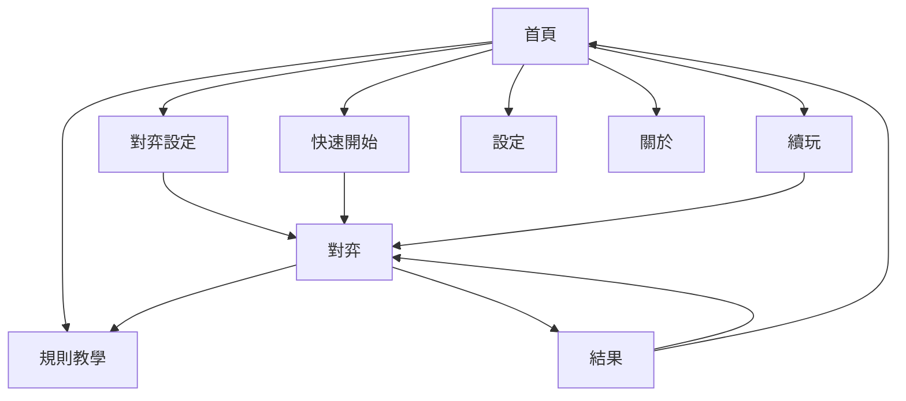
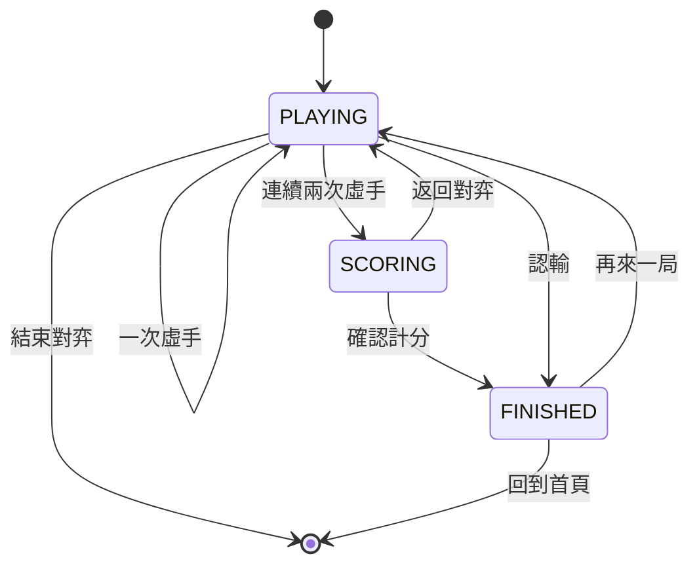
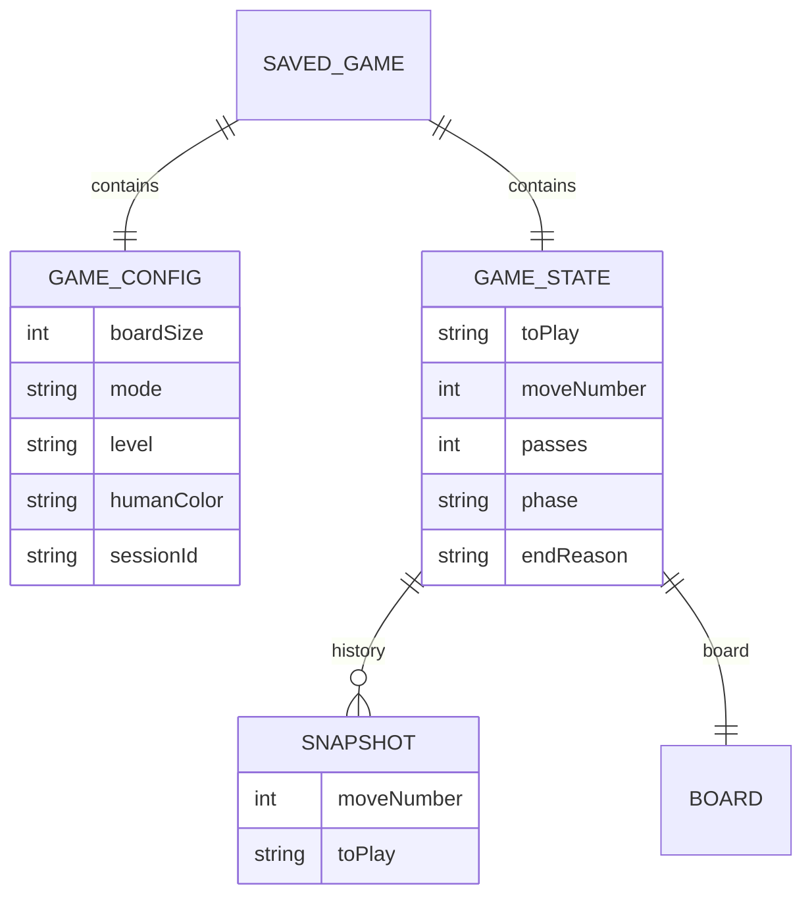

# mini圍棋 系統設計文件

本文件從產品與系統設計角度說明 mini圍棋的目標、使用者流程、功能規格、規則決策與後續方向。

## 1. 產品定位

mini圍棋是一款給初學與中階玩家的離線圍棋 App。目標不是提供職棋級對弈，而是讓玩家：

1. 理解棋盤、氣、提子、打吃、禁入、劫與虛手。
2. 在 9 路小棋盤上完成一局並理解勝負。
3. 透過提示、悔棋、座標與計分明細建立基礎觀念。
4. 在沒有網路的情況下隨時練習。

## 2. 設計目標

- **容易開始**：9 路為預設，首頁提供快速開始。
- **規則透明**：非法手、打劫、自殺手、虛手與計分都有文字說明。
- **學習導向**：提示顯示座標、最後一手顯示座標、計分顯示子／地明細。
- **低操作成本**：常用功能集中在對局畫面；返回時自動保存。
- **離線與隱私**：不需帳號、不連網、不收集資料。

## 3. 目標使用者

### 初學者

- 不熟悉圍棋規則。
- 需要小棋盤與清楚的錯誤提示。
- 需要教學、提示與簡單 AI。

### 中階練習者

- 已懂基本規則，想練習布局與局部戰鬥。
- 需要 13 路、較強 AI、悔棋與快速重開。
- 可能使用平板或橫向模式。

## 4. 使用情境

1. 第一次開啟 App，查看規則教學後用 9 路入門 AI 下第一局。
2. 中途離開 App，之後從首頁續玩。
3. 對局中打開規則教學查閱「打劫」，返回後繼續。
4. 連續虛手後標記死子，查看子／地明細並確認結果。
5. 想重新練習同一設定，從更多選單選「重新開始」。
6. 使用快速開始，以預設設定直接開局。
7. 在設定中改成 13 路、中級、執白，之後快速開始即沿用。

## 5. 畫面流程

首頁右上角「更多」提供設定與關於。對局右上角「更多」提供重新開始、規則教學與結束對弈。

## 6. 對局狀態設計

### 階段定義

- `PLAYING`：可落子、虛手、悔棋、提示、認輸。
- `SCORING`：可標記死子、清除標記、確認計分或返回對弈。
- `FINISHED`：顯示結果，可查看棋盤、再來一局或回首頁。

## 7. 功能規格

### 7.1 新局

- 棋盤：9 路或 13 路。
- 模式：電腦或雙人。
- 電腦難度：入門、初級、中級。
- 執子：黑或白；雙人模式固定由黑先手。
- 貼目：固定 6.5，白棋加。

### 7.2 對弈

- 點擊交叉點落子。
- 非法手顯示原因：
  - 已有棋子。
  - 自殺手。
  - 打劫立即回提。
- 最後一手以紅色圓環標記。
- 顯示手數、最後一手座標、提子數與貼目。
- AI 思考時顯示「電腦思考中…」並暫停玩家操作。
- AI 虛手時顯示「電腦虛手」。

### 7.3 輔助功能

| 功能 | 規則 |
| --- | --- |
| 悔棋 | 最多回溯 80 手；對 AI 模式退回到玩家回合。 |
| 提示 | 使用中級 AI 評估，顯示藍色圓環與座標。 |
| 虛手 | 雙方連續虛手進入計分。 |
| 認輸 | 確認後立即結束，對方勝。 |
| 結束對弈 | 確認後刪除存檔並回首頁，不顯示勝負。 |
| 重新開始 | 沿用設定開新局，需確認。 |

### 7.4 計分

- 中國規則數子法。
- 死子由玩家點選棋組標記，可再點取消。
- 可一次清除所有死子標記。
- 即時顯示子、地、中立與合計。
- 白棋加 6.5 目。
- 確認後顯示勝方、合計、勝差。

### 7.5 結果

- 勝方、合計分數、勝差。
- 認輸時顯示「某某勝（對方認輸）」。
- 可關閉結果查看棋盤，再以「查看結果」開啟。
- 可再來一局或回首頁。

### 7.6 續玩

- 每次狀態變更自動存檔。
- 正常離開前會先完成存檔。
- 首頁顯示續玩卡：棋盤、模式、難度、手數。
- 可捨棄存檔。
- 新局以 `sessionId` 區分，避免誤讀舊局。

### 7.7 教學

8 頁靜態圖文：

1. 棋盤
2. 氣
3. 提子
4. 打吃
5. 禁入點
6. 打劫
7. 虛手
8. 勝負判定

教學可從首頁或對局選單進入。對局中進入教學後，返回仍在原對局。

### 7.8 設定

- 顯示模式：跟隨系統／淺色／深色。
- 動態配色。
- 顯示座標。
- 落子震動。
- 預設對弈模式。
- 預設棋盤。
- 預設難度。
- 預設執子。

## 8. 規則設計決策

| 項目 | 決策 | 原因 |
| --- | --- | --- |
| 計分 | 中國規則數子法 | 手機端判定較直觀，初學者容易理解「棋子＋地」。 |
| 貼目 | 白棋 6.5 目 | 避免和棋，符合常見入門規則。 |
| 劫 | 簡易劫 | 禁止立即回提，規則清楚且實作穩定。 |
| 死子 | 手動標記 | 自動死活判斷複雜且容易誤判。 |
| 棋盤 | 9 路／13 路 | 符合 mini 定位與手機操作。 |
| 讓子 | 不支援 | 保持第一版規則與 AI 平衡簡單。 |
| 19 路 | 不支援 | 手機棋盤過小，AI 與操作成本較高。 |

## 9. AI 設計

| 難度 | 行為 | 適合 |
| --- | --- | --- |
| 入門 | 合法手隨機加上少量評分 | 第一次下棋 |
| 初級 | 提子、叫吃、避免自殺與自填氣 | 已懂基本規則 |
| 中級 | 靜態評分＋一手對手威脅 | 想有一點挑戰 |

- 思考時間：9 路 700ms、13 路 1500ms。
- 結束對局、悔棋、開新局時會取消計算。
- AI 只會回傳合法手或虛手。

## 10. 資料設計

設定與對局分開儲存：

- 對局：`current_game.json`，AtomicFile。
- 設定：DataStore Preferences。

## 11. 錯誤與邊界處理

- **非法手**：Snackbar 顯示原因。
- **存檔失敗**：Snackbar 提示，不中斷對局。
- **AI 逾時**：回傳目前最佳合法手。
- **AI 無合法手**：虛手並提示。
- **程序重建**：依 `sessionId` 與 config 還原對局。
- **教學導覽返回**：保留原對局 ViewModel。
- **結束對弈**：等待待寫入存檔完成後再清除，避免舊進度被寫回。

## 12. 使用者體驗決策

- 9 路為預設，降低第一次進入門檻。
- 首頁提供快速開始，但也保留完整設定。
- 首次進入顯示教學提示，不強制跳頁。
- 提示與最後一手顯示座標，順便學習座標。
- 計分顯示子／地明細，而不只顯示總分。
- 結果可關閉以檢視終局盤面。
- 破壞性操作（認輸、結束、重新開始、捨棄存檔）皆有確認。
- 棋盤尺寸依螢幕高度調整，控制按鈕保持可見。
- 教學示意棋盤縮小並置中，降低捲動。

## 13. 無障礙與國際化

- 所有按鈕均有文字或 `contentDescription`。
- 棋盤提供整體內容描述。
- 使用 Material 3 元件與 Typography。
- 預設語言為繁體中文。
- 目前尚未提供逐點 TalkBack 落子與座標輸入，列為後續方向。

## 14. 非目標

- 職棋等級 AI。
- 線上對戰、帳號、排行榜。
- 自動死活判斷。
- 19 路完整棋盤。
- 廣告、訂閱或資料分析。

## 15. 後續方向

- 音效與錯誤震動。
- 落子二次確認或幽靈棋子。
- 計分領地視覺化。
- 手數標記與棋譜復盤。
- 讓子棋與 19 路。
- 逐點無障礙操作。
- Macrobenchmark 與 Compose UI 測試。
